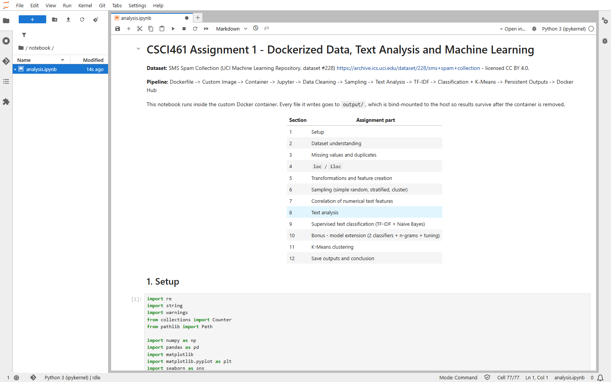
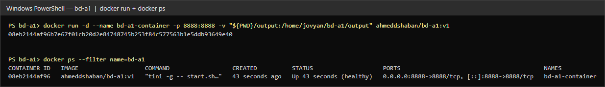

# CSCI461 Assignment 1 - Dockerized Data, Text Analysis and Machine Learning

**Nile University - CSCI461 Introduction to Big Data - Fall 2026**

Spam detection on the **SMS Spam Collection** dataset, fully reproducible inside a custom Docker image
built on `quay.io/jupyter/scipy-notebook`.

```
Dockerfile -> Custom Image -> Container -> Jupyter -> Data Cleaning -> Sampling -> Text Analysis
           -> TF-IDF -> Classification + K-Means -> Persistent Outputs -> Docker Hub
```

| | |
|---|---|
| **GitHub repository** | <https://github.com/ahmeddshaban/bd-a1> |
| **Docker Hub image** | [`ahmeddshaban/bd-a1:v1`](https://hub.docker.com/r/ahmeddshaban/bd-a1) (also tagged `latest`) |
| **Dataset** | SMS Spam Collection - UCI ML Repository #228 (CC BY 4.0) |
| **Notebook** | [`notebook/analysis.ipynb`](notebook/analysis.ipynb) |
| **Main result** | TF-IDF + Multinomial NB: accuracy 0.974, spam F1 0.893 - best tuned model (Logistic Regression): accuracy 0.988, spam F1 0.954 |

## Team

| Member | ID | Main responsibility |
|---|---|---|
| Ahmed Shaban Mohamed | 231001388 | Docker environment, Docker Hub, bonus model extension (Section 10), screenshots |
| Omar Tamer Helal | 231000661 | Data analysis and preprocessing (Sections 2-7), README |
| Mohanad Elbehairy | 231000095 | Text analysis and insights (Section 8) |
| Jana Mohamed Farouk | 231000729 | Machine learning: classification, K-Means, outputs (Sections 9, 11, 12) |

Every member can explain every part of the project (see the [discussion cheat sheet](#discussion-cheat-sheet)).

---

## 1. Project structure

```
bd-a1/
├── Dockerfile              # custom image definition
├── requirements.txt        # extra Python packages (installed on top of the base image)
├── .dockerignore           # files that are NOT sent to the Docker build
├── README.md
├── data/
│   └── dataset.csv         # SMS Spam Collection (label, message) - 5,574 rows
├── notebook/
│   └── analysis.ipynb      # the full analysis (runs top-to-bottom with Restart & Run All)
├── output/                 # bind-mounted -> everything the notebook writes survives the container
│   ├── cleaned_data.csv
│   ├── model_metrics.txt
│   ├── cluster_summary.txt
│   └── figures/            # 11 PNG figures
└── screenshots/            # evidence: build, images, ps, logs, inspect, push, pull, JupyterLab
    └── logs/               # the raw text output of every Docker command
```

## 2. Dataset

* **Source:** <https://archive.ics.uci.edu/dataset/228/sms+spam+collection> (Almeida & Hidalgo, 2011). License **CC BY 4.0**, so it can be redistributed - it is included in `data/dataset.csv`.
* **One row** = one SMS message plus its label: `ham` (legitimate, 4,827) or `spam` (747).
* **Columns:** `label` (category / target), `message` (text). Numerical features are created in the notebook.
* The original file `SMSSpamCollection` is tab-separated without a header. It was converted once on the host with:

```python
import csv
rows = [l.rstrip("\r\n").split("\t", 1) for l in open("SMSSpamCollection", encoding="utf-8")]
with open("data/dataset.csv", "w", newline="", encoding="utf-8") as f:
    w = csv.writer(f); w.writerow(["label", "message"]); w.writerows(rows)
```

## 3. Get the project

```bash
git clone https://github.com/ahmeddshaban/bd-a1.git
cd bd-a1
```

Or download the ZIP from the GitHub page (Code -> Download ZIP), or skip this and use the Docker Hub image (Option A below).

## 3b. Requirements

* Docker Desktop (Windows / macOS) or Docker Engine (Linux), running.
* About 6 GB of free disk space (the Jupyter SciPy base image is large).
* A free Docker Hub account (only needed to **push**; pulling a public image needs no login).

## 4. The Docker image

```dockerfile
FROM quay.io/jupyter/scipy-notebook:latest                       # base image (Python, pandas, sklearn, Jupyter)
COPY --chown=${NB_UID}:${NB_GID} requirements.txt /tmp/requirements.txt
RUN pip install --no-cache-dir -r /tmp/requirements.txt           # extra packages (wordcloud)
RUN mkdir -p /home/jovyan/bd-a1/data /home/jovyan/bd-a1/notebook /home/jovyan/bd-a1/output/figures
COPY --chown=${NB_UID}:${NB_GID} data/dataset.csv /home/jovyan/bd-a1/data/dataset.csv
COPY --chown=${NB_UID}:${NB_GID} notebook/analysis.ipynb /home/jovyan/bd-a1/notebook/analysis.ipynb
WORKDIR /home/jovyan/bd-a1                                         # project folder = working directory
EXPOSE 8888
```

* `--chown=${NB_UID}:${NB_GID}` makes the copied files belong to the notebook user `jovyan`, so Jupyter can edit them.
* Each instruction creates an **image layer**. Layers are cached: if only the notebook changes, Docker reuses the
  base image and the `pip install` layer and rebuilds only the last few layers.
* **Why the image contains the full notebook (not an empty one):** the assignment asks to copy the notebook
  into the image. We copy the final version so that anyone who pulls `ahmeddshaban/bd-a1:v1` can reproduce every
  result immediately with *Restart and Run All* (or `nbconvert --execute`), without any extra files from the host.
  The outputs themselves are **not** in the image (`output/` is excluded by `.dockerignore`); they are produced at
  run time and saved through the bind mount.

## 5. Reproduce the project - step by step

All commands are run from inside the `bd-a1` folder. The `-v` part is different per shell because the
current folder is written differently:

| Shell | Current-folder syntax |
|---|---|
| Windows PowerShell | `${PWD}` |
| Windows cmd | `%cd%` |
| macOS / Linux / Git Bash | `$(pwd)` |

### Option A - use the published image from Docker Hub (fastest)

```powershell
docker pull ahmeddshaban/bd-a1:v1
docker run -d --name bd-a1-container -p 8888:8888 -v "${PWD}/output:/home/jovyan/bd-a1/output" ahmeddshaban/bd-a1:v1
```

### Option B - build the image yourself from this folder

```powershell
# 1) build the custom image (tag it with the Docker Hub username)
docker build -t ahmeddshaban/bd-a1:v1 -t ahmeddshaban/bd-a1:latest .

# 2) check that the image exists
docker images ahmeddshaban/bd-a1

# 3) run a container: JupyterLab on port 8888 + bind mount for output/
docker run -d --name bd-a1-container -p 8888:8888 -v "${PWD}/output:/home/jovyan/bd-a1/output" ahmeddshaban/bd-a1:v1
```

macOS / Linux / Git Bash:

```bash
docker run -d --name bd-a1-container -p 8888:8888 -v "$(pwd)/output:/home/jovyan/bd-a1/output" ahmeddshaban/bd-a1:v1
```

Windows cmd:

```bat
docker run -d --name bd-a1-container -p 8888:8888 -v "%cd%\output:/home/jovyan/bd-a1/output" ahmeddshaban/bd-a1:v1
```

### Open JupyterLab and run the notebook

```powershell
docker logs bd-a1-container          # copy the URL that contains ?token=...
```

1. Open `http://127.0.0.1:8888/lab?token=<token>` in the browser.
2. Open `notebook/analysis.ipynb`.
3. **Kernel -> Restart Kernel and Run All Cells**. It takes about 30-60 seconds.
4. The results appear in `output/` **on your machine** (bind mount).

Run it without the browser (same result):

```powershell
docker exec bd-a1-container jupyter nbconvert --to notebook --execute --inplace notebook/analysis.ipynb
```

> Optional: to keep notebook edits after the container is removed, also mount the notebook folder:
> `-v "${PWD}/notebook:/home/jovyan/bd-a1/notebook"`

### Container lifecycle commands

```powershell
docker images                      # list images (our custom image + the base image)
docker ps                          # running containers
docker ps -a                       # all containers, including stopped ones
docker logs bd-a1-container        # container output (Jupyter URL and token)
docker inspect bd-a1-container     # full JSON: image, state, ports, mounts, env ...
docker stop bd-a1-container        # stop (the container still exists -> docker ps -a)
docker start bd-a1-container       # start it again
docker rm bd-a1-container          # remove the container - output/ stays on the host
```

## 6. Key concepts

### Image vs container

* An **image** is a read-only template built from the `Dockerfile`: the base OS + Python + packages + our
  dataset and notebook, stored as stacked layers. `ahmeddshaban/bd-a1:v1` is an image.
* A **container** is a running (or stopped) **instance** of an image, with its own writable layer, processes,
  network and name. `bd-a1-container` is a container. One image can start many containers
  (we ran `bd-a1-container` and `bd-a1-pulltest` from the same image). Removing a container does not remove the image.
* Analogy: image = class, container = object.

### Port mapping `-p 8888:8888`

The format is **`HOST_PORT:CONTAINER_PORT`**.

* The **right** number (`8888`) is the port JupyterLab listens on **inside** the container.
* The **left** number (`8888`) is the port opened on **our machine**. Docker forwards
  `localhost:8888` on the host to port `8888` in the container.
* Without `-p` the container is isolated and the browser cannot reach Jupyter.
* If 8888 is already used on the host, change only the left side: `-p 8889:8888` -> open `http://localhost:8889`.
  (We did this for the reproducibility test.)

### Bind mount for persistent output `-v <host folder>:<container folder>`

* `-v "${PWD}/output:/home/jovyan/bd-a1/output"` links the host folder `bd-a1/output` with the container folder
  `/home/jovyan/bd-a1/output`. Both paths point to the **same files**.
* The notebook writes `cleaned_data.csv`, `model_metrics.txt`, `cluster_summary.txt` and `figures/*.png` there,
  so they appear on the host immediately and **stay after `docker rm`** (see `screenshots/08_bind_mount_persistence.png`).
* Files written anywhere else in the container live in the container's writable layer and are lost when it is removed.
* **Bind mount vs volume:** a bind mount uses a folder *we choose* on the host (easy to open, good for results we
  submit). A **named volume** (`docker volume create x`, `-v x:/path`) is managed by Docker inside its own storage
  area - more portable and better for databases, but not as easy to browse from the host.

## 7. Docker Hub distribution

| | |
|---|---|
| Repository | `ahmeddshaban/bd-a1` - <https://hub.docker.com/r/ahmeddshaban/bd-a1> |
| Tags | `v1` (submitted version) and `latest` (same digest) |
| Digest | `sha256:0c3051906900e2fe1905054d683f7d3695472c8932f76f9717edb6fcdc642b70` |

Commands used to publish:

```powershell
docker login                                              # Docker Hub username: ahmeddshaban
docker build -t ahmeddshaban/bd-a1:v1 -t ahmeddshaban/bd-a1:latest .
docker push ahmeddshaban/bd-a1:v1
docker push ahmeddshaban/bd-a1:latest
```

If you build the image under a different name first, tag it with `docker tag bd-a1:latest ahmeddshaban/bd-a1:v1`.

**Reproducibility check** - a team member, on their own machine, runs:

```powershell
docker pull ahmeddshaban/bd-a1:v1
mkdir output
docker run -d --name bd-a1-pulltest -p 8888:8888 -v "${PWD}/output:/home/jovyan/bd-a1/output" ahmeddshaban/bd-a1:v1
docker exec bd-a1-pulltest jupyter nbconvert --to notebook --execute --inplace notebook/analysis.ipynb
type output\model_metrics.txt        # macOS/Linux: cat output/model_metrics.txt
```

The metrics must be the same as in this repository (all random steps use `random_state=42`).
See `screenshots/10_docker_pull_and_run.png`.

## 8. What the notebook does

| Section | Content |
|---|---|
| 2 Dataset understanding | `head`, `shape`, `columns`, `dtypes`, `info`, `describe`, class balance, what a row is, column roles |
| 3 Missing values / duplicates | 0 missing; 403 exact duplicates + 11 that differed only by leading/trailing spaces = 414 rows dropped (justified); shape 5,574 -> 5,160 |
| 4 `loc` / `iloc` | conditional `loc` (long spam that mentions "free"), positional `iloc`, `iloc[np.r_[0:3, 100:103, -3:0]]` |
| 5 Transformations | type conversion (`category`), encoding (`label_num`), 9 created features, binning (`length_bin`), min-max normalisation |
| 6 Sampling | simple random, stratified, cluster (10 of 50 blocks) + 300-repeat stability experiment |
| 7 Correlation | heatmap of 9 numeric text features + label; strong/weak pairs; correlation is not causation |
| 8 Text analysis | `cleaned_text` (lowercase, URLs/e-mails/currency/numbers -> tokens, punctuation & spaces), tokens, top-20 before/after stop words, spam vs ham comparison, word clouds, 6 written insights |
| 9 Classification | stratified 80/20 split, TF-IDF, Multinomial NB, accuracy/precision/recall/F1, confusion matrix, interpretation, limitations |
| 10 Bonus | NB vs Logistic Regression vs Linear SVM + n-grams + `GridSearchCV` (5-fold stratified CV) |
| 11 K-Means | TF-IDF -> TruncatedSVD(50) -> normalise; k = 2..12 experiment (silhouette + elbow); cluster sizes, silhouette, top terms, representative messages, comparison with labels |
| 12 Outputs | `cleaned_data.csv`, `model_metrics.txt`, `cluster_summary.txt`, figures |

### Results

**Supervised (test set, 1,032 messages, spam = positive class)**

| Model | Accuracy | Precision (spam) | Recall (spam) | F1 (spam) |
|---|---|---|---|---|
| Multinomial NB (baseline, Section 9) | 0.974 | 0.904 | 0.883 | 0.893 |
| Multinomial NB tuned + bigrams | 0.984 | 0.951 | 0.914 | 0.932 |
| **Logistic Regression tuned** | **0.988** | 0.946 | **0.961** | **0.954** |
| Linear SVM tuned + bigrams | 0.986 | 0.945 | 0.945 | 0.945 |

**K-Means (k = 2):** silhouette 0.063, ARI vs labels 0.488. Cluster 1 ("numbers, prices, calls to action")
contains 92.2% of all spam; cluster 0 is personal conversation (1.3% spam). The silhouette score was low for every
k (0.06-0.11) with no clear peak, so k was chosen from the structure of the data (commercial vs personal senders).

### Output files

| File | Content |
|---|---|
| `output/cleaned_data.csv` | 5,160 cleaned rows: original text, `cleaned_text`, engineered features, length bin, cluster |
| `output/model_metrics.txt` | metrics, classification report, confusion matrix, bonus model comparison |
| `output/cluster_summary.txt` | silhouette per k, chosen k, cluster sizes, composition, top terms, interpretation |
| `output/figures/correlation_heatmap.png` | correlation heatmap |
| `output/figures/word_frequency_top20.png` | top-20 words before / after stop-word removal |
| `output/figures/group_comparison_spam_vs_ham.png` | spam vs ham length, word count, top-10 words |
| `output/figures/confusion_matrix_nb.png` | confusion matrix of the main model |
| `output/figures/confusion_matrix_best_model.png` | confusion matrix of the best tuned model |
| `output/figures/model_comparison.png` | bonus: classifier comparison |
| `output/figures/sampling_comparison.png` | class distribution of the three sampling methods |
| `output/figures/length_distribution_by_class.png` | length histogram by class |
| `output/figures/wordclouds_ham_spam.png` | word clouds |
| `output/figures/kmeans_k_selection.png` | elbow + silhouette for k = 2..12 |
| `output/figures/kmeans_clusters_vs_labels.png` | cluster composition and 2-D projection |

## 9. Screenshots

| Evidence | File |
|---|---|
| `docker build` | `screenshots/01_docker_build.png` |
| `docker images` | `screenshots/02_docker_images.png` |
| `docker run` + `docker ps` (running container) | `screenshots/03_docker_run_and_ps.png` |
| notebook executed inside the container | `screenshots/04_docker_exec_notebook.png` |
| `docker stop` + `docker ps -a` | `screenshots/05_docker_ps_a.png` |
| `docker logs` | `screenshots/06_docker_logs.png` |
| `docker inspect` (+ image inspect / history = layers) | `screenshots/07_docker_inspect.png` |
| `docker rm` -> outputs still on the host | `screenshots/08_bind_mount_persistence.png` |
| `docker push` | `screenshots/09_docker_push.png` |
| `docker pull` + run of the published image | `screenshots/10_docker_pull_and_run.png` |
| JupyterLab running in the container | `screenshots/jupyter_lab_running_in_container.png` |
| Kernel -> Restart Kernel and Run All | `screenshots/jupyter_restart_and_run_all.png` |
| notebook results (13 screenshots) | `screenshots/jupyter_*.png` |

The terminal screenshots show the real output of each command (the raw text is in `screenshots/logs/`; the
Jupyter token is partly hidden in the logs).




## Discussion cheat sheet

* **Dockerfile -> image -> container:** the Dockerfile is the recipe, `docker build` turns it into an image
  (read-only layers), `docker run` starts a container (image + writable layer + process).
* **Image layers:** every `FROM/RUN/COPY` instruction adds a layer; layers are cached and shared between images,
  which makes rebuilds and pushes fast (`docker history ahmeddshaban/bd-a1:v1`).
* **Registry / repository / tag:** Docker Hub is the *registry*, `ahmeddshaban/bd-a1` is the *repository*,
  `v1` / `latest` are *tags* (names for one image digest).
* **Port mapping:** `-p HOST:CONTAINER` (see above).
* **Bind mount vs volume:** see above.
* **Missing values / duplicates:** none missing; exact duplicates removed so they do not inflate frequencies or
  leak between train and test.
* **loc vs iloc:** `loc` selects by *label / condition*, `iloc` by *integer position*; `np.r_` concatenates several
  position ranges into one index array.
* **Sampling:** simple random = everyone equal chance; stratified = sample inside each class (keeps proportions);
  cluster = pick whole groups (cheap but higher variance when groups are homogeneous).
* **Correlation:** Pearson r between -1 and 1 measures linear association only; correlation does not imply causation.
* **TF-IDF:** term frequency x inverse document frequency - a word gets a high weight when it is frequent in this
  message but rare in the whole corpus; the vectorizer is fitted on the training set only.
* **Metrics:** precision = of predicted spam, how many are spam; recall = of real spam, how many we caught;
  F1 = harmonic mean; accuracy is misleading with 87% ham.
* **Why K-Means is unsupervised:** it never uses the label - it only minimises the distance of each message to its
  cluster centre. Labels are used only *afterwards* to describe the clusters; cluster IDs are arbitrary.
